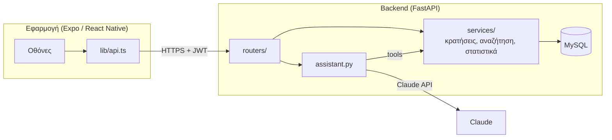

# 🏖️ SmartBeach – Σύστημα κρατήσεων ξαπλώστρας για Beach Bars

Full-stack σύστημα όπου οι πελάτες κλείνουν ξαπλώστρα **πάνω σε οπτικό χάρτη της παραλίας**, για συγκεκριμένο
χρονικό διάστημα, και μπαίνουν με **QR code**. Οι διαχειριστές έχουν **dashboard με στατιστικά**, και ένας
**AI βοηθός** (Claude) βρίσκει διαθέσιμες θέσεις και ετοιμάζει κρατήσεις μέσα από συζήτηση.

## Τεχνολογίες

| Κομμάτι | Τεχνολογία |
|---|---|
| Εφαρμογή | React Native, Expo SDK 54, Expo Router, TypeScript, react-native-svg |
| Backend | Python 3, FastAPI, Pydantic |
| Βάση | MySQL 8 / MariaDB (connection pool, transactions) |
| Ασφάλεια | JWT, bcrypt, ρόλοι user / staff / admin, SecureStore στο κινητό |
| AI | Claude API (Anthropic) με tool use |
| Ποιότητα | pytest (40 tests σε πραγματική βάση), Locust, GitHub Actions, Docker |

## Λειτουργίες

**Πελάτης**
- Αναζήτηση παραλιών με **φίλτρα**: ημερομηνία, ώρες, τύπος (κανονική/VIP), μέγιστη τιμή, μόνο διαθέσιμες,
  ταξινόμηση κατά διαθεσιμότητα, τιμή, όνομα ή **απόσταση** (GPS).
- **Οπτικός χάρτης ξαπλωστρών**: η σειρά 1 είναι δίπλα στη θάλασσα, χρώματα για ελεύθερη / VIP / κλεισμένη /
  εκτός λειτουργίας, και θέσεις που δεν ταιριάζουν στα φίλτρα εμφανίζονται αχνές.
- **Κρατήσεις ανά χρονικό διάστημα** (πρωί, απόγευμα, ολοήμερο ή ελεύθερες ώρες ανά μισάωρο). Η ίδια ξαπλώστρα
  μπορεί να κλειστεί το πρωί από έναν και το απόγευμα από άλλον.
- Τιμή **μισής μέρας** με έκπτωση (έως 6 ώρες: 60% της ημερήσιας τιμής, ρυθμίζεται).
- «Οι κρατήσεις μου»: επερχόμενες / παλαιότερες / ακυρωμένες, **QR εισόδου**, αλλαγή ώρας, ακύρωση.
- **AI βοηθός**: «Βρες μου VIP για Σάββατο απόγευμα κάτω από 20€» → ψάχνει, προτείνει θέση, και ο χρήστης
  επιβεβαιώνει με ένα κουμπί.

**Προσωπικό (staff)**
- **Check-in με σάρωση QR** (κάμερα) ή πληκτρολόγηση κωδικού, λίστα σημερινών αφίξεων.

**Διαχειριστής (admin)**
- **Dashboard**: έσοδα, κρατήσεις, πληρότητα, μέση αξία, ακυρώσεις, check-in, γραφήματα ανά μήνα/ημέρα/ημέρα
  εβδομάδας/διάστημα/παραλία και **heatmap δημοφιλών θέσεων**. Κάθε γράφημα έχει και προβολή πίνακα.
- Κρατήσεις με φίλτρα (πελάτης, παραλία, κατάσταση, ημερομηνία), ακύρωση και αλλαγή ώρας.
- Γεννήτρια πλέγματος ξαπλωστρών και επεξεργασία κάθε θέσης (τιμή, τύπος, εκτός λειτουργίας).
- Παραλίες (προσθήκη, επεξεργασία, διαγραφή, συντεταγμένες από GPS) και χρήστες (αναζήτηση, αλλαγή ρόλου).

## Αρχιτεκτονική



```
backend/
  app/
    main.py            εκκίνηση, χειρισμός σφαλμάτων
    config.py          ρυθμίσεις από .env
    db.py              connection pool + transactions
    security.py        bcrypt, JWT, έλεγχος ρόλων
    booking_rules.py   κανόνες: σεζόν, ωράριο, επικάλυψη, τιμολόγηση
    services/          λογική (κοινή για REST και AI βοηθό)
    routers/           REST endpoints
    assistant.py       AI βοηθός (Claude tool use)
  tests/               pytest
  scripts/             create_admin.py, seed_demo.py
  loadtest/            Locust
database/schema.sql    σχήμα βάσης
SmartBeachApp/         εφαρμογή Expo
docs/axiologisi.md     υλικό για το κεφάλαιο αξιολόγησης (tests, load test, SUS)
```

### Πώς αποτρέπεται η διπλή κράτηση

Αν δύο πελάτες πατήσουν «Κράτηση» στην ίδια θέση την ίδια στιγμή, ένας απλός έλεγχος «είναι ελεύθερη;» και
μετά `INSERT` δεν αρκεί, γιατί και οι δύο θα δουν «ελεύθερη». Γι' αυτό κάθε κράτηση γίνεται σε **transaction**
που πρώτα **κλειδώνει τη γραμμή της ξαπλώστρας** (`SELECT … FOR UPDATE`). Το δεύτερο αίτημα περιμένει, βλέπει
την πρώτη κράτηση και απορρίπτεται με `409 Conflict`. Το `tests/test_concurrency.py` το αποδεικνύει
με 20 ταυτόχρονα αιτήματα.

Δύο διαστήματα `[a, b)` και `[c, d)` επικαλύπτονται όταν `a < d` και `c < b`. Έτσι τα 08:00–14:00 και
14:00–20:00 **δεν** συγκρούονται.

### Πώς δουλεύει ο AI βοηθός

Ο βοηθός χρησιμοποιεί το Claude API με **tool use**. Το μοντέλο δεν έχει πρόσβαση στη βάση. Μπορεί μόνο να
καλέσει 4 εργαλεία που γράψαμε εμείς:

| Εργαλείο | Τι κάνει |
|---|---|
| `search_beaches` | Αναζήτηση παραλιών με τιμές και διαθεσιμότητα |
| `get_sunbed_availability` | Ελεύθερες θέσεις μιας παραλίας για ημερομηνία και ώρες |
| `get_my_bookings` | Οι κρατήσεις **του συνδεδεμένου** χρήστη (όχι άλλων) |
| `propose_booking` | Ελέγχει και **προτείνει** κράτηση. Δεν κάνει κράτηση |

Η κράτηση γίνεται μόνο όταν ο χρήστης πατήσει «Επιβεβαίωση» στην κάρτα που εμφανίζεται
(**human-in-the-loop**). Έτσι ένα λάθος του μοντέλου δεν μπορεί να χρεώσει κανέναν χωρίς τη συγκατάθεσή του.
Τα εργαλεία χρησιμοποιούν τα ίδια services με την εφαρμογή, οπότε ο βοηθός βλέπει ακριβώς τα ίδια δεδομένα.

Αν το μοντέλο αρνηθεί ένα αίτημα λόγω φίλτρων ασφαλείας, το API το ξανατρέχει αυτόματα σε εναλλακτικό μοντέλο
(server-side fallback).

---

## Εγκατάσταση

### Προαπαιτούμενα
- Python 3.10+
- Node.js 20+
- MySQL 8 ή MariaDB 10.6+ (π.χ. το XAMPP, που περιέχει MariaDB)
- Την εφαρμογή **Expo Go** στο κινητό
- (Προαιρετικά) κλειδί Claude API από το https://platform.claude.com για τον βοηθό

### 1. Βάση δεδομένων

Τρέξε το `database/schema.sql` (από phpMyAdmin → Import, ή από τερματικό). **Προσοχή: σβήνει και ξαναφτιάχνει
τη βάση `smartbeach`.**

```bash
mysql -u root -p < database/schema.sql
```

### 2. Backend

```bash
cd backend
python -m venv .venv
```

Windows:
```bash
.venv\Scripts\activate
```

macOS / Linux:
```bash
source .venv/bin/activate
```

```bash
pip install -r requirements.txt
```

Αντίγραψε το `backend/.env.example` σε `backend/.env` και συμπλήρωσε κωδικό βάσης, `SECRET_KEY` και
(προαιρετικά) `ANTHROPIC_API_KEY`.

Δημιούργησε τον πρώτο διαχειριστή (η εφαρμογή δεν επιτρέπει σε κανέναν να γίνει admin με εγγραφή):

```bash
python -m scripts.create_admin --email admin@smartbeach.gr --name Admin
```

(Προαιρετικά) δοκιμαστικά δεδομένα για demo: ξαπλώστρες, 80 πελάτες και ~11.000 κρατήσεις σε μία σεζόν,
με κωδικό `demo1234` για όλους τους demo λογαριασμούς:

```bash
python -m scripts.seed_demo
```

Εκκίνηση. Το `--host 0.0.0.0` χρειάζεται για να φαίνεται ο server από το κινητό:

```bash
uvicorn app.main:app --host 0.0.0.0 --port 8000 --reload
```

Τεκμηρίωση του API (Swagger): http://localhost:8000/docs

### 3. Εφαρμογή

```bash
cd SmartBeachApp
npm install
npx expo start
```

Σκάναρε το QR με το Expo Go. Κινητό και υπολογιστής πρέπει να είναι **στο ίδιο Wi-Fi**. Η εφαρμογή βρίσκει
μόνη της τον server, άρα **δεν χρειάζεται πια να γράφεις την IP σου στον κώδικα**. Η διεύθυνση φαίνεται κάτω
από τη φόρμα σύνδεσης. Αν χρειαστεί να την αλλάξεις, δες το `SmartBeachApp/.env.example`.

### Εναλλακτικά: Docker

```bash
docker compose up --build
```

Ξεκινά MySQL και backend. Μετά, για δοκιμαστικά δεδομένα:

```bash
docker compose exec api python -m scripts.seed_demo
```

## Tests

```bash
cd backend
pip install -r requirements-dev.txt
python -m pytest
```

Τα tests χρειάζονται MySQL/MariaDB και φτιάχνουν δική τους βάση `smartbeach_test`. Ρύθμιση σύνδεσης με
`TEST_DB_HOST`, `TEST_DB_USER`, `TEST_DB_PASSWORD`. Για load test και ερωτηματολόγιο ευχρηστίας (SUS) δες το
[docs/axiologisi.md](docs/axiologisi.md).

## Κύρια endpoints

| Μέθοδος | Διαδρομή | Ποιος |
|---|---|---|
| POST | `/auth/register`, `/auth/login` | όλοι |
| GET | `/beaches?date=&start_time=&end_time=&type=&max_price=&available_only=&sort=&lat=&lon=` | όλοι |
| GET | `/beaches/{id}/sunbeds?date=&start_time=&end_time=` | όλοι |
| POST | `/bookings` | πελάτης |
| GET | `/bookings/me?scope=upcoming\|past\|cancelled` | πελάτης |
| PUT / POST | `/bookings/{id}/time`, `/bookings/{id}/cancel` | πελάτης |
| POST | `/assistant/chat` | πελάτης |
| POST | `/staff/checkin`, GET `/staff/bookings` | staff, admin |
| GET | `/admin/stats`, `/admin/bookings`, `/admin/users` | admin |
| POST / PUT / DELETE | `/admin/beaches…`, `/admin/sunbeds/{id}` | admin |
